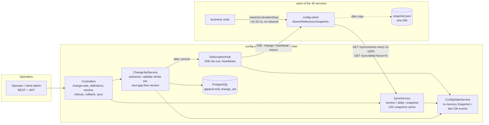
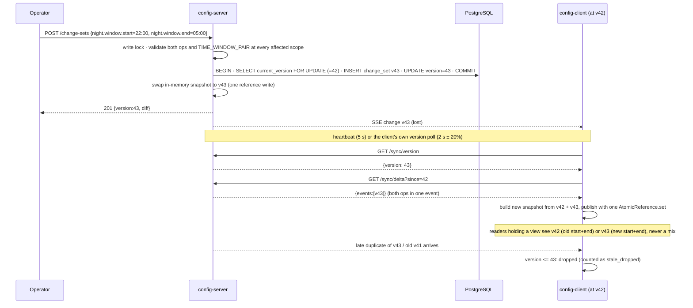

# Design note: hierarchical tenant configuration with live propagation

## 1. Architecture

`config-core` (plain Java, no dependencies) holds everything that decides correctness: types and rules,
most-specific-wins resolution, the change-set validator, immutable snapshots, the version guard, diff
and rollback planning. Server and client both use it, so the server's validation and the client's
resolution can never disagree.

## 2. Hardest flow: an atomic change set reaching a client that missed a push

## 3. Consistency model

The server is the single writer and the source of truth. Every change set is validated as a whole,
then written in one database transaction that assigns the next **gap-free** version. Only then is it
published, so there is one total order of versions and nothing visible is ever lost on a crash. Each
client applies versions strictly in order, one change set at a time, by swapping an immutable snapshot.
That gives every client **monotonic reads** (it never goes back to an older version) and **change-set
atomicity** (a reader sees all of a change set or none of it; with a pinned `ConfigView` this holds
across several keys). Clients are **eventually consistent with bounded staleness**. A connected client
normally sees a change in milliseconds through push, and within one poll interval plus a round trip
(about 2.4 s worst case by construction, under 5 s) if the push is lost. Two services can briefly
disagree, within that window. When the server is unreachable, clients choose **availability**: they
keep serving their last good snapshot, with staleness that is unbounded but measured
(`config_client_staleness_ms`), and catch up from their version when the server returns.

**Version 41 after 43.** The client compares the incoming version with its own:
- An event with version ≤ its own is a duplicate or arrived out of order. It is dropped and counted.
- Version 43 → 45 means 44 was missed. The client does not apply 45; it fetches `delta?since=43`.
- A rollback never re-sends an old version. It is a **new** version (for example 44) whose content
  equals the old one.
- Version numbers are only comparable **within one history**. The server's change log has a random
  `historyId`, created once per database. It comes with every version check, delta and SSE heartbeat
  (the heartbeat is sent before any backlog on a new stream), and the client stores it with its disk
  snapshot.
  - **Different history** (database wiped or replaced): the client discards its snapshot and installs
    the server's full state, even if that state has a lower version, and counts `history_resets`.
    Without this, a client holding v10 from the old database would treat the new database's v1…v10 as
    stale and keep serving old values. Snapshots written before history ids existed count as "unknown"
    and are replaced once, on first contact.
  - **Same history, lower server version** (for example, the database restored from an old backup):
    the client keeps its snapshot and counts `server_behind`. Versions only move forward within a
    history.

## 4. Failure modes

| What fails | What the user / service sees | How the system recovers |
|---|---|---|
| Config server process dies | Reads keep answering from memory (2.1 M reads served during a 2 s outage in the test); writes fail with connection errors | Clients retry with full-jitter backoff (250 ms → 10 s). On restart the server replays the change log and clients resume with `since=<their version>` |
| Server crashes after commit, before push | Clients briefly keep the previous value | Change is durable; heartbeat / version poll / reconnect delta delivers it (kill-the-server test: 1.0–1.8 s after restart) |
| A push is lost, duplicated or reordered | Nothing; at most one poll interval of extra staleness | Gap → delta fetch; duplicate / older version dropped (EndToEndIT, fault injector) |
| Database down | Writes return 5xx/503, nothing is half-applied; reads, push and sync of existing state keep working from memory | Retry the write; the version row lock and transaction keep the log consistent |
| Invalid value or half of a related pair | 422 with every violation listed; version does not move; nothing is published | Fix and resubmit |
| Concurrent writers | One wins per version; `expectedVersion` mismatch → 409 | Re-read and retry; idempotency keys make retries safe |
| 500 clients reconnect at once | Stream/handshake spread over ~10 s by jitter; reads never stop | Delta-from-version (no full snapshots), LRU-cached full snapshots, bounded snapshot builds with 503 + Retry-After |
| Service restarts while server is down | Starts from the checksummed disk copy and serves it | Catches up when the server is reachable |
| Disk copy corrupted / torn | File is rejected (checksum) and counted | Falls back to the server; if neither is available startup fails loudly instead of serving defaults |
| Server database wiped or replaced while services keep their disk snapshots | Services serve their old snapshot only until the first contact with the new server | The `historyId` mismatch makes each client discard its snapshot and install the server's state; later changes apply normally (EndToEndIT, live check) |
| Half-open TCP (silent stream) | Nothing | No event for 5 s (handshake) / 20 s (idle) closes and reopens the stream; polling continues meanwhile |
| Expired / invalid token | 401 | Client invalidates and re-authenticates on the next call |

## 5. Staleness and caching

- **Client snapshot (the hot-data cache).** It holds the whole tenant-visible configuration, so it
  never evicts and a read never misses. It is stale only between a commit and its arrival:
  milliseconds with push, at most poll interval × 1.2 + one round trip without push, and without a
  bound (but measured) while the server is unreachable.
- **Server LRU (256 entries)** of tenant-filtered full snapshots keyed by `(version, tenant set)`. An
  entry can never be stale, because the key includes the version; eviction only costs a rebuild.
- **Server event window.** The last 10,000 events are kept in memory for deltas. Older clients get a
  full snapshot instead.

## 6. Deliberate trade-offs

- **Availability over consistency on the read path.** Serving a possibly stale value beats failing a
  booking.
- **Single writer instead of a cluster.** One server instance gives a trivially total order and
  gap-free versions. High availability for writes (leader election, or Postgres `LISTEN/NOTIFY`
  fan-out across replicas) is left out on purpose.
- **Event-sourced log, rebuilt at startup.** This is simple and auditable. Startup is O(total ops);
  periodic checkpoints were left out.
- **Full snapshot per client.** A client holds every key for its tenants (~30k overrides ≈ a few MB),
  which is what makes reads microsecond-cheap.
